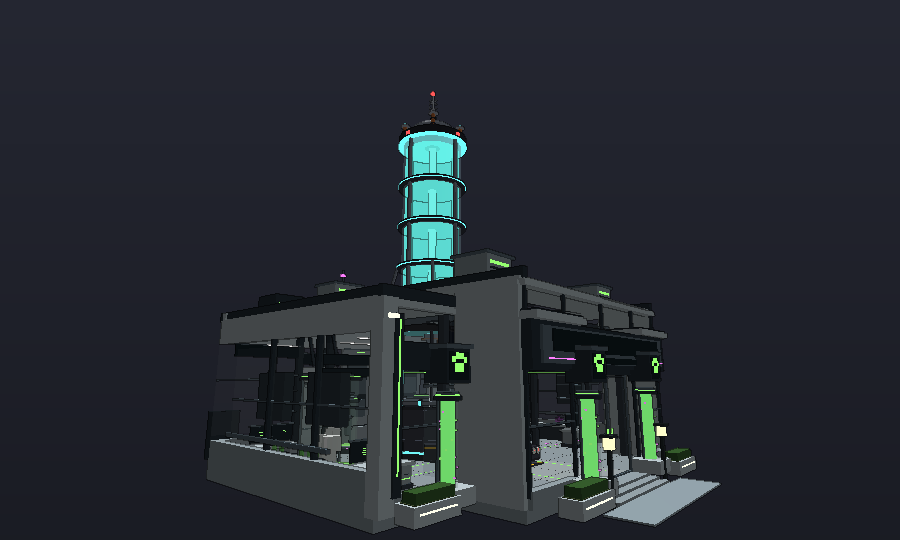
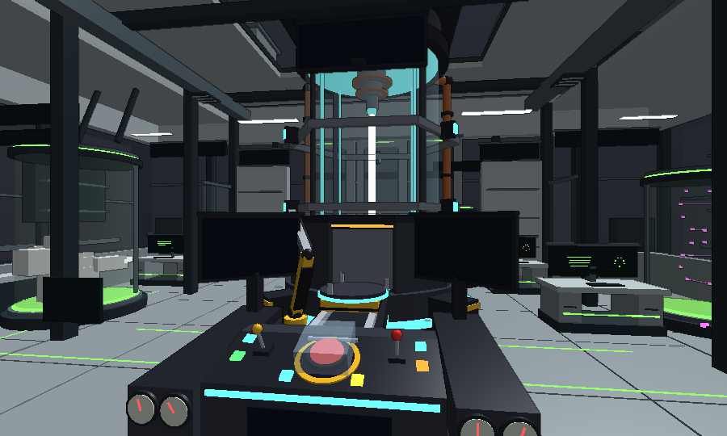
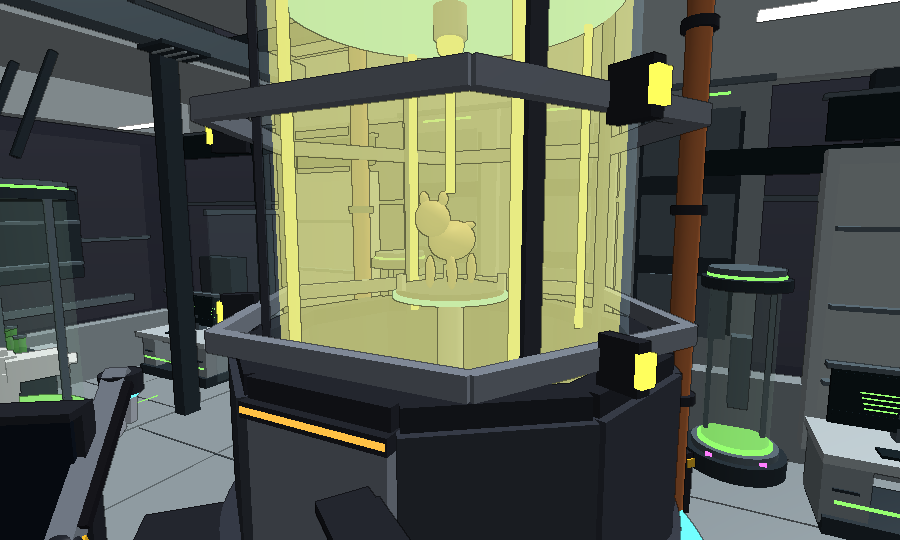

# Лаборатория мутаций — ЯДЕРНАЯ МУТАЦИОННАЯ МАШИНА

Руководство для владельца игры. Старая лаборатория с пятью операциями заменена одной огромной
машиной и самым простым меню: **выбери собаку → посмотри шансы и цену → МУТИРОВАТЬ**. Главное в
блоке — зрелищная анимация мутации, после которой хочется нажать ещё раз.

---

## 1. Как это выглядит

В центральном зале «Лаборатории мутаций» вместо старой камеры-капсулы стоит машина:

* **Тяжёлый пьедестал** (Ø 25) с подсвеченной кромкой, четырьмя контрфорсами в жёлто-чёрную полосу и
  болтами. Над ним — **загрузочное кольцо** с дверью, обращённой к пульту.
* **Стеклянная труба** Ø 17 от пола до потолка зала. Внутри: светящийся пол, четыре вертикальные
  **энергетические шины**, тонкая **колонна ядра** по оси, **инжектор** (конус с наконечником), который
  свисает с **мембраны** под потолком. Вокруг стекла — рёбра, два шестигранных **вращающихся кольца**
  с неоновыми лопастями и медные трубы охлаждения на задней стороне.
* Труба проходит **сквозь потолок и крышу** (световой фонарь вырезан, вокруг — металлическая площадка,
  обрамление и четыре распорки) и поднимается до высоты ~106: стекло, **светящаяся зелёная жидкость**,
  **ядро** по оси, три кольца-бандажа. Наверху — **крышка** с куполом, четыре **катушки Теслы**, красные
  **сигнальные огни** и **антенна с маяком**. Это ориентир, который видно из всего района.
* **Пульт** перед трубой (со стороны входа): помост оператора, большой наклонный стол с **красной
  кнопкой АКТИВАЦИЯ** под откидной стеклянной крышкой в жёлто-чёрном кольце, два **рычага**, цветные
  клавиши, четыре **стрелочных прибора**, два больших **экрана** на стойках («РЕАКТОР» и «БАЗОВЫЕ ШАНСЫ»)
  и висящее табло **«☢ МУТАЦИОННАЯ МАШИНА ☢»**.
* Между пультом и трубой — **рельсы с лифтом** (жёлтая каретка, телескопическая мачта, площадка с
  подсветкой) и **роботизированная рука**, которая ставит собаку на площадку.

## 2. Как пользоваться (игрок)

1. Зайди в Лабораторию мутаций и подойди к пульту — над кнопкой появится подсказка **АКТИВАЦИЯ**
   (клавиша E или нажатие на экран). Подсказка видна только в радиусе 7,5 студа от кнопки и при прямой
   видимости, как и раньше. Плитка LAB в HUD и старые кнопки «Лаборатория» открывают то же окно; если
   игрок далеко, окно предлагает **ПОКАЗАТЬ ПУТЬ**.
2. **Шаг 1 — выбери собаку.** Карточки всех твоих собак: сначала самые редкие, с тегом текущей мутации,
   поиск по имени (и по-русски). Собаки, которые не могут войти в машину (в пути, на витрине, недоступна),
   бледные — нажатие показывает причину. Заблокированная, избранная или работающая в будке собака
   выбирается, а вместо кнопки МУТИРОВАТЬ появляется кнопка, которая сразу это исправит
   (РАЗБЛОКИРОВАТЬ, ИЗ БУДКИ…).
3. **Шаг 2 — МУТИРОВАТЬ.** Большая 3D-картинка собаки, её текущая мутация и **все возможные результаты**
   цветными плашками: шанс в процентах и прибавка к доходу (например, «Золотой 5% · +30% дохода»).
   Плашка с текущим вариантом помечена «СЕЙЧАС». Ниже — цена (монеты и кости, красным то, чего не
   хватает) или **ПЕРВАЯ ПОПЫТКА БЕСПЛАТНО**. Если собака уже мутирована, видно предупреждение
   «Можно потерять: ЗОЛОТОЙ», а кнопку нужно **удерживать** 1,2 с.
4. Окно закрывается и играет анимация (её можно пропустить нажатием). Потом — **карточка результата**:
   * мутация: «ЗОЛОТОЙ!», «Обычный → Золотой», «Доход +30%»;
   * без мутации: «СТАБИЛЬНО — БЕЗ МУТАЦИИ», «Совсем рядом!» и честная подсказка
     «Следующая попытка: шанс мутации 23%» (число берётся из настоящих шансов);
   * кнопки **МУТИРОВАТЬ СНОВА** (та же собака, на кнопке новая цена; удержание, если собака теперь
     мутирована), **ДРУГАЯ СОБАКА**, **ЗАКРЫТЬ**.

Что не изменилось (экономика сохранена): цена мутации **5 000 + 1 500 × ранг монет и 5 × ранг костей**
(ранг: обычная 1 … секретная 6), первая мутация бесплатна, шансы **обычный 77 % / блестящий 15 % /
золотой 5 % / искажённый 2 % / глитчевый 0,8 % / пустотный 0,2 %** с бонусами мировых событий и дерева
улучшений, остывание камеры 7 с, удержание для переброса уже мутированной собаки, защита от двойного
списания, запрет во время обмена. Собака всегда остаётся у игрока.

## 3. Анимация мутации

| Фаза | Длительность | Что происходит |
|---|---|---|
| Активация | 0,7 с | Камера у пульта: откидывается крышка, нажимается красная кнопка, тянутся рычаги, мигают сигнальные огни, сирена |
| Загрузка | 1,5 с | Рука опускается к лифту, собака материализуется на площадке (белая вспышка, искры), дверь уезжает вниз, каретка везёт собаку в трубу, дверь закрывается |
| Подъём | 1,0 с | Мачта поднимает собаку в центр трубы, поднимается жидкость с пузырями, раскручиваются кольца, гаснет колонна ядра |
| Барабан | 2,6 с | Энергия: луч из инжектора в собаку, электрические дуги от шин, искры, стрелки приборов в красной зоне, тряска камеры. Цвет трубы и надпись перебирают все мутации, как барабан игрового автомата, всё медленнее, и останавливаются на результате сервера |
| Пауза | 0,35 с | Цвет результата мигает |
| Превращение | 1,3 с | Взрыв: вспышка-сфера, две ударные волны, фонтан частиц цвета результата, вспышка экрана, тряска; собака проявляется с подсветкой нового варианта (такой же, как у собак в будках), жидкость сливается, камера наезжает |

Итого ~7,5 с. Если результат «обычный», барабан перед остановкой проходит «блестящий» — эффект «почти»;
шансы при этом нигде не искажаются (результат — бросок сервера, проценты — настоящие).

* **Пропуск:** нажатие/клик/пробел — сразу к превращению, повторное — к карточке.
* **Reduced Motion** (настройка Roblox или атрибут игрока `ReducedMotion`): короткая версия 2,2 с без
  движения камеры, тряски и мигания — собака сразу в трубе, плавная смена цвета, мягкая вспышка.
* **Low FX** (атрибуты `LowFX` / `WorldEventFX = Low` или низкое качество графики): меньше частиц, без дуг.
* **Другие игроки** рядом (до 170 студов) видят короткий публичный эффект: труба разгорается ~5,6 с и
  вспыхивает цветом результата. Собаку и камеру видит только тот, кто мутирует.
* После карточки собака исчезает из трубы, машина возвращается в покой (медленно вращаются кольца,
  пульсирует ядро, мигает маяк, идут пузыри) — только пока игрок ближе 220 студов.

## 4. Что убрано

Извлечение ДНК («расщепление»), генное наведение, катализаторы и кристаллы-стабилизаторы, возвышение,
рецепты и банк ДНК исчезли из игры: окна для них нет, а сервер в режиме `SimpleMode` отвечает
«Мутационная машина только перебрасывает мутации». **Данные игроков не трогаются:** `p.Lab` (ДНК, история,
открытые рецепты, счётчики) остаётся в сохранении и проходит проверку, возвышение собак (A1–A3) по-прежнему
даёт свой бонус к доходу, собаки из рецептов остаются ценными. Странная ДНК, которая иногда выпадает при
мутации, продолжает тихо копиться (на случай отката).

## 5. Как попробовать в Studio

1. **Play**, дойти до Лаборатории мутаций (или карта → Lab), подойти к пульту, нажать **E**.
2. Новый игрок: первая мутация бесплатна. Чтобы проверить платную — сделать одну мутацию.
3. Удержание: замутировать собаку до блестящей и нажать МУТИРОВАТЬ снова — кнопка требует удержания,
   на сервере без подтверждения переброс не пройдёт.
4. Короткая версия: включить Reduced Motion в настройках Roblox или выполнить в командной строке
   `game.Players.LocalPlayer:SetAttribute('ReducedMotion', true)`.
5. Публичный эффект: **Test → Clients and Servers → 2 Players**, один игрок мутирует, второй стоит рядом.

## 6. Что и где настраивать

| Что | Где |
|---|---|
| Режим машины (`SimpleMode = true`) и откат на старую лабораторию (`false`) | `ReplicatedStorage/LabConfig` |
| Строить ли машину в зале (`MachineWorld`; `false` — старая камера и терминал) | `ReplicatedStorage/LabConfig` |
| Тайминги анимации `Machine = {Activate, Load, Rise, Reel, Hold, Reveal, Reduced, PublicBurst}` | `ReplicatedStorage/LabConfig` |
| Цена мутации `Costs.Mutation`, остывание `Cooldown`, дистанция кнопки `Distance` | `ReplicatedStorage/LabConfig` |
| Шансы и прибавка к доходу вариантов | `ReplicatedStorage/DogEconomy/Config` (`Variants`, общие для всей игры) |
| Геометрия: размеры трубы, высоты, путь лифта, поза руки, ракурсы камеры, цвета мира | `ReplicatedStorage/MutationMachineLayout` |
| Сама модель (детали, материалы, цвета, тексты экранов) | `ServerScriptService/MutationMachineBuild` |
| Окно | `StarterGui/ScreenGui/Modules/MutationLabScreen` (на UI-ките, `docs/UIKIT.md`) |
| Анимация, покой и публичный эффект | `StarterGui/ScreenGui/Modules/LabPresentation` |
| Звуки (встроенные звуки Roblox; свои — id в `AssetIds`) | `ReplicatedStorage/LabAudioConfig` |
| Русские тексты (окно, анимация, экраны машины, ответы сервера) | `ReplicatedStorage/Localization/Lab` |

**Откат.** `LabConfig.SimpleMode = false` возвращает старое окно с пятью операциями (`Modules.LabScreen`),
сервер снова принимает все процедуры, кнопка снова «ИСПОЛЬЗОВАТЬ ЛАБОРАТОРИЮ». `MachineWorld = false`
оставляет зал без машины (старая камера-капсула и терминал). Старый код не удалён.

## 7. Производительность

* Машина — **~270 деталей** (бюджет 450; вместе с обрезанными кусками крыши — 274), **4 источника света** (камера, ядро над крышей, маяк, прожектор
  над пультом), одна модель с `ModelStreamingMode = Atomic` (подгружается целиком, когда игрок рядом).
* Старые детали зала не удаляются: скрываются (прозрачность и столкновения), исходные значения хранятся
  в атрибутах `MutationMachine_*`; `MutationMachineBuild.Uninstall` возвращает всё как было.
* В покое на клиенте нет покадровых скриптов: только твины (кольца, ядро, маяк, шины) и эмиттер
  пузырей, и только ближе 220 студов; проверка расстояния раз в 2 с.
* Анимация считает кадры только пока играет. Все эффекты (вспышка, луч, кольца ударной волны, 4 дуги,
  3 эмиттера, коррекция цвета, экран вспышки) созданы один раз и переиспользуются; копия собаки и её
  проигрыватель анимации создаются на одну мутацию и уничтожаются после карточки (утечек нет и после
  сотни мутаций). Все изменения деталей машины запоминаются и восстанавливаются.
* Публичный эффект для других игроков — ~7 с работы на одну чужую мутацию в радиусе 170 студов.

## 8. Для разработчика

* **Сервер.** `MutationMachineWorld.server` при старте вызывает `MutationMachineBuild.Install(lab)`:
  скрывает `CentralChamber`, вырезает световой фонарь, балку и поперечину крыши (на их месте —
  обрезанные копии в `MutationMachine.RoofCut`), строит `05_MutationLab.MutationMachine` и переносит
  `InteractionAnchor` к кнопке — подсказка `GeneticsPrompt` (`LabService.Start`) и проверка
  `LabAccess.CanUse` работают без изменений.
* **Протокол** прежний (`LabInfo` → `LabPreview` → `LabCommit`). В `SimpleMode`: `LabPreview` принимает
  только `{Procedure='Mutation', Uids={uid}, PrimaryUid?}`, коммит проверяет, что план — мутация;
  `LabInfo` отдаёт `Simple`, `Odds` (`{Name, Percent, Bonus}` с бонусами), `Costs`, `Machine`,
  `TutorialComplete`, `CooldownEndsAt`. Квоты, подпись плана, идемпотентность, остывание, удержание
  (`Acknowledge`), запрет при обмене — без изменений.
* **Публичный эффект:** после успешного коммита сервер пишет на модель лаборатории атрибуты
  `MachinePulseUser`, `MachinePulseVariant`, `MachinePulseAt`, затем `MachinePulse` (счётчик).
* **Имена для анимации:** `Lift.{Carriage, Mast, Platform}`, `IntakeDoor`, `Rotor1/Rotor2` (корень
  `RotorHub`, остальное приварено), `ChamberLiquid`, `LiquidSurface`, `CoreBeam`, `EnergyRail1..4`,
  `Membrane`, `InjectorTip`, `ChamberLight`, `Core`, `UpperLiquid`, `Beacon`, `WarningLight1..4`,
  `PlacerArm.{Turret, Upper, Fore, Claw}` (обратная кинематика — `MutationMachineLayout.ArmPose`),
  `ButtonGuard`, `ButtonDome`, `LeverL/LeverR`, `GaugeNeedle1..4` (атрибут `Pivot`), экраны
  `ScreenL/ScreenR/MainSign/DeskPlate` (`SurfaceGui Display`).
* **Окно** открывается через `GUIIntegration.openLab` (по `SimpleMode`), окно Kit с ключом `Lab`.
  Во время анимации навигацию держит `N.BeginReward`, после — снова открывается окно с карточкой; при её
  закрытии вызывается `LabPresentation.Release()`.
* **Тесты:** `tests/lab.luau` — только мутация в `SimpleMode` (остальное отклоняется), шансы и цены по
  рангам, бесплатная первая попытка, удержание, идемпотентность, остывание, обмен, старый профиль с ДНК,
  историей, рецептами и возвышенными собаками, режим отката, бюджеты модели (детали, свет), отсутствие
  пересечений с балками и крышей, досягаемость кнопки, обратимая установка и снятие, барабан и
  кинематика руки, русские строки окна, анимации и экранов, наличие всех звуков.
* **Превью без Studio:** сцена `MutationMachineBuild.Build()` на заглушке пола и сцена с настоящим
  плейсом (`Install` на десериализованной `05_MutationLab`) рендерятся `tools/qa/render.py` — так
  проверены вид снаружи, вид игрока у пульта и кадры анимации.
