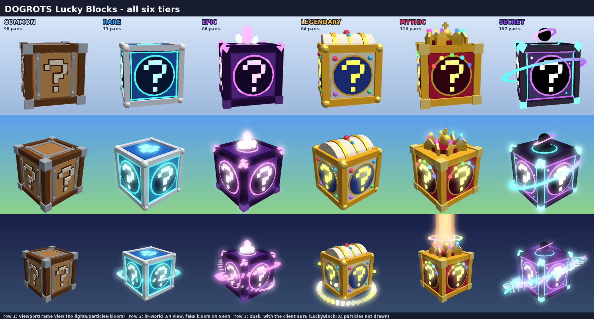

# Лаки-блоки — новый вид, открытие, рулетка, появление на конвейере

Экономика не менялась: шансы, пулы наград, цены и сохранения те же. Сервер, как и раньше, сам
выбирает собаку. Всё новое — только показ.



## Что поменялось

| Что | Как теперь |
|---|---|
| **Модели блоков** (`LuckyBlockVisuals`) | 6 новых моделей. Common — деревянный ящик. Rare — синий техно-куб. Epic — фиолетовый магический куб с рунами. Legendary — костяно-золотой сундук с куполом. Mythic — малиновый королевский ящик с короной. Secret — «чёрная дыра»: тёмное ядро, кольцо горизонта событий и вихрь. |
| **Аура** (`LuckyBlockFX`) | Постоянное свечение, искры и лучи у каждого блока по редкости. Обновляется только у 14 ближайших блоков. На Low упрощается. |
| **Появление на конвейере** (`LuckyArrivalFX`) | Блок выезжает из пасти конвейера со своей анимацией для каждой редкости: вспышка, кольца, баннер «РЕДКИЙ / ЭПИЧЕСКИЙ…». Secret — мини-катсцена: тьма стягивается в точку, молнии, взрыв пустоты по языку конвейера, баннер на весь экран. |
| **Портал в конце ленты** (`DogLinePortalFX`) | Блок, который доехал до конца, затягивает в портал. Купленный блок лопается с искрами. |
| **Открытие на паде** (`LuckyLifecycleFX`) | Нажал E → блок поднимается, трясётся и раскручивается, по трещинам идёт свет, вверх бьёт луч цвета редкости, искры втягиваются внутрь → **взрыв** (кольца, осколки, вспышка, лёгкая тряска камеры). Другие игроки рядом видят то же самое, а после закрытия окна над падом крутится голограмма выпавшей собаки. |
| **Рулетка** (`LuckyReel`) | Появляется ровно в момент взрыва. Лента с 3D-карточками собак из пула этого блока (редкие пролетают реже) замедляется и останавливается на выпавшей собаке. Иногда рядом мелькает «почти выпала» более редкая. Затем карточка награды с лучами и конфетти. SKIP / Escape сразу показывают результат. |
| **Secret из блока** | Рулетка останавливается, показывает «СМОТРИ НА СВОЙ ДВОР» и закрывается. Сразу после этого на участке начинается штатная катсцена Secret. |

Пока зарядка не закончилась, промпты своих падов не реагируют. Так второе нажатие E не откроет
второй блок или меню выбора блока прямо под рулеткой.

## Как проверить в Studio

1. Откройте `build/DOGROTS_MINING.rbxl` и нажмите Play.
2. Блок нужной редкости на конвейер можно поставить из командной строки **сервера**. Это работает
   только в неопубликованном плейсе (`GameId == 0`):
   ```lua
   game.ServerScriptService.DogLineSpawner.SpawnLuckyBlock:Invoke('Secret') -- Common, Rare, Epic, Legendary, Mythic, Secret
   ```
3. Купите блок, поставьте его на пад, дождитесь READY и нажмите E. Проверьте Common, Epic, Mythic и Secret.
4. Проверьте SKIP и Escape посреди прокрутки: должна появиться одна карточка награды, без второй вспышки.
5. Режим телефона: Device Emulator в Studio. На Low и с Reduced Motion вспышек и тряски камеры нет.

## Звуки

Звуки собраны из встроенных звуков Roblox (`rbxasset://`), поэтому работают сразу.
Чтобы поставить свои, загрузите их и впишите id в `ReplicatedStorage.Lucky.LuckyAudio`:
`Audio.AssetIds = {Charge=…, Burst=…, Tick=…, Land=…, Reveal=…, Void=…, …}`. Значение 0 — встроенный звук.

## Изменённые скрипты

- Новые: `ReplicatedStorage/Lucky/LuckyShow`, `ReplicatedStorage/Lucky/LuckyAudio`,
  `StarterGui/ScreenGui/Modules/LuckyReel`, `StarterPlayerScripts/LuckyArrivalFX`.
- Переписаны: `ReplicatedStorage/LuckyBlockVisuals`, `StarterPlayerScripts/LuckyBlockFX`,
  `StarterPlayerScripts/LuckyLifecycleFX`.
- Небольшие правки:
  - `RewardScreens`: результат лаки-блока идёт в рулетку, при ошибке — в старое окно.
  - `ServerScriptService/Economy/LuckyLifecycle`: атрибуты результата для зрителей и `RevealAt` для Secret.
  - `DogLineSpawner`: блок стримится целиком, плюс атрибут `SpawnedAt`.
  - `DogLinePortalFX`.
  - `DOGROTS_AutoTranslateUI`: 16 новых строк.

Всё проверено сборкой, luau-lsp и эмуляцией в Lune: конвейер, пад, зритель, ошибка открытия,
рулетка, Secret, SKIP/Escape, телефон. В настоящем движке Roblox это ещё не запускалось, так что
тайминги и яркость эффектов стоит посмотреть глазами в Studio.
