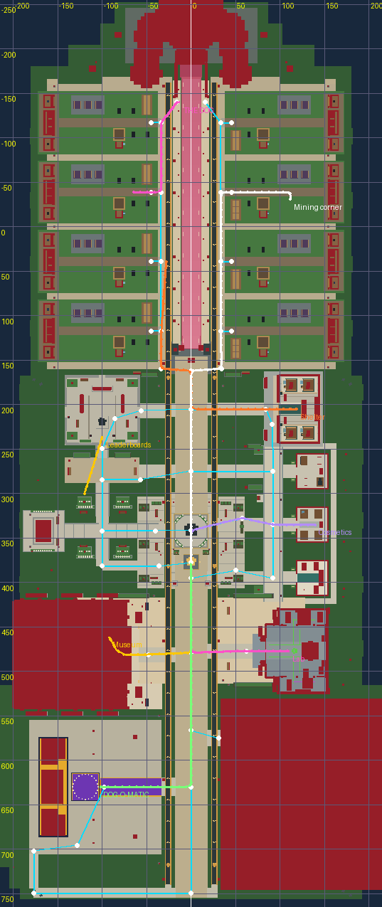
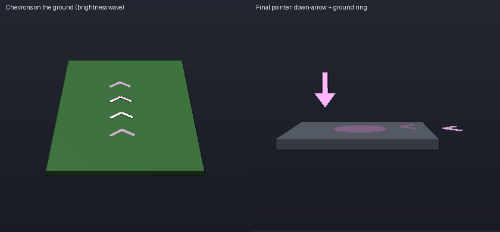
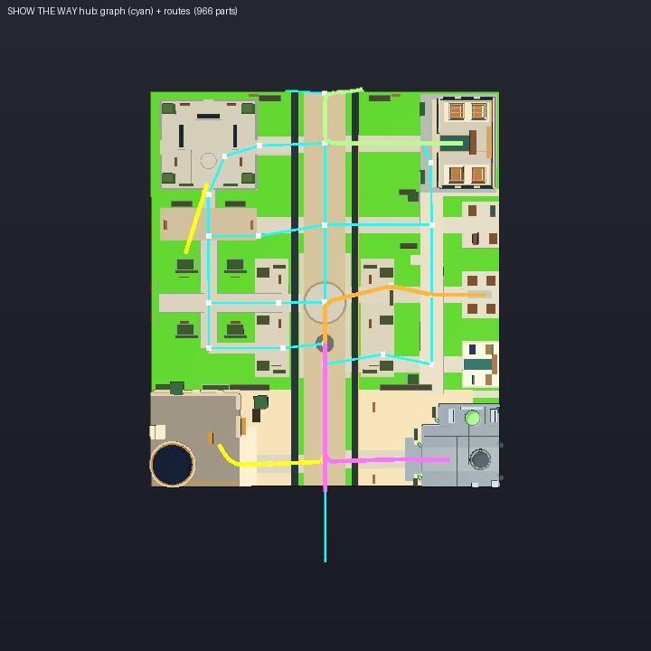

# «Показать путь»: навигация по району

Игрок нажимает «ПОКАЗАТЬ ПУТЬ» (в окне «КУДА ИДТИ?», на карте района или любую старую кнопку
«SHOW THE WAY») — и по земле от него до цели бегут светящиеся стрелки-шевроны: по настоящим
улицам, с плавными поворотами, через двери (лаборатория, музей, приют, магазины) до самого
объекта. У цели — подпрыгивающая неоновая стрелка вниз, пульсирующее кольцо на земле и табличка
с названием и расстоянием. В углу экрана — плашка «▲ ЛАБА 120 м ✕».

*Голубое — граф улиц (53 узла), цветное — посчитанные маршруты: от спавна к лаборатории, музею,
DOG-O-MATIC, косметике; от участка к приюту, к шахте своего участка, к СОБАКЕ; через сад к
площади рекордов. Красное — стены и препятствия плейса.*

## Что изменилось

- **Маршрут, а не метка.** Раньше «SHOW THE WAY» ставил одну табличку в 9 studs над целью.
  Теперь строится путь по графу улиц: главный бульвар, ответвления к каждому зданию,
  внутренние променады участков, дорожки площади рекордов, сада и южной петли.
- **Стрелки на земле.** Шевроны лежат на земле (высота берётся лучом вниз один раз на точку
  маршрута, игроки и собаки игнорируются), плывут к цели, по ним бежит волна яркости, на
  поворотах стрелки поворачиваются вдоль скруглённой линии. Видны только на участке
  10–90 studs впереди игрока.
- **Финальный указатель** у объекта: стрелка вниз (поворачивается к камере), кольцо на земле,
  табличка с названием и оставшимся расстоянием (в метрах = studs).
- **Сбился с пути — пересчёт.** Отошёл от маршрута больше чем на 12 studs (проверка 4 раза в
  секунду) — путь строится заново от текущего места. Телепорт, смерть, смена участка —
  тоже пересчёт.
- **Пришёл — исчезает.** В 8 studs от цели: вспышка кольца и «ТЫ НА МЕСТЕ!», через 1,6 с всё
  убирается. Убрать вручную — ✕ на плашке (это бывшая кнопка CLEAR MARKER) или «СТОП» в окне.
- **Окно «КУДА ИДТИ?»** (клавиша **N**, или `N.OpenPage('Navigate')` — кнопку в HUD добавляет
  другой блок): карточки мест с иконкой, подписью, расстоянием по маршруту и кнопкой
  «ПОКАЗАТЬ ПУТЬ»; фильтры «МОЙ УЧАСТОК / МАГАЗИНЫ / АТТРАКЦИОНЫ»; закрытые места
  (Глобальное событие, Пустота) — серые и неактивные. На телефоне — строки списка.
- **Карта района (M)**: у каждого места справа кнопка «ПОКАЗАТЬ ПУТЬ», у активного —
  «● В ПУТИ». Карта больше не тикает каждый кадр, когда закрыта. Исправлена ошибка:
  позиция своего участка записывалась в строку «Почта разработчиков».
- **Новые места**: мой участок (вход), мои будки, шахтёрский уголок, лифт в шахту, витрина
  «ЛУЧШИЕ НАХОДКИ», мой скупщик; магазины экипировки, косметики, припасов (до терминала
  внутри); лаборатория ведёт через стеклянную дверь к пульту машины мутаций (114, 3, 477);
  музей — по лестнице к стойке DOGDEX.
- **Все старые вызовы работают**: имена сопоставляются по ключу, названию (без учёта регистра и
  знаков) и синонимам — «Your yard», «Factory», «THE DOG», «Mutation lab», «DOG-O-MATIC PLAZA»,
  «Dog Shelter», «Feedback», «Event headquarters», «Paw square»… Новые кнопки могут передавать
  ключи: `N.Navigate('MiningCorner')`, `N.OpenPage('Navigate', 'Equipment')`.

## Как попробовать в Studio

1. Play. Нажми **N** → выбери «Лаборатория мутаций» → «ПОКАЗАТЬ ПУТЬ». Окно закроется,
   побегут фиолетовые стрелки; иди по ним — к двери лаборатории и внутрь к пульту.
2. Сверни в сторону метров на 15 — через ¼ секунды маршрут перестроится.
3. Нажми **M** — карта района; любая строка или точка на схеме запускает путь.
4. Старые кнопки: «FIND DOG-O-MATIC» (события, магазин, награды), «SHOW THE WAY» в
   лаборатории и Догдексе, онбординг «SHOW MY YARD» — все ведут стрелками.
5. Свой участок: «Шахтёрский уголок» / «Витрина» / «Скупщик» строятся для участка из атрибута
   игрока `YardId`; пока участок не выдан — подсказка «Участок ещё не готов».
6. Reduced Motion (настройки Roblox) или атрибут игрока `ReducedMotion = true` — стрелки стоят
   на месте, без волны и подпрыгивания. Низкое качество графики (1–3), атрибут `LowFX` или
   `WorldEventFX = "Low"` — 8 стрелок вместо 16 (окно 10–50 studs).
7. Телефон: плашка маршрута встаёт в свободную зону HUD (`UITheme.LayoutHUD`), окно — список.

## Что и где настраивать

| Что | Где |
|---|---|
| Узлы и рёбра графа (улицы) | `ReplicatedStorage/Navigation/RouteGraph.luau`: `NODE_LIST`, `EDGE_LIST` (Y — поверхность, по которой идёшь) |
| Куда именно ведёт место (док, точки внутри, цель, указатель) | там же, `RouteGraph.Targets`; места участка — в координатах участка `{x', z}` |
| Стены и препятствия, которые маршрут не пересекает | там же, `box(...)` (прямоугольники XZ) |
| Список мест, названия RU/EN, иконки, цвета категорий, синонимы | `ReplicatedStorage/Navigation/Destinations.luau` |
| Стрелки: шаг, окно, скорость, волна, число (и для слабых устройств) | `ReplicatedStorage/Navigation/ArrowFlow.luau` (`Defaults`, `Low`) |
| Пересчёт, прибытие, высота над землёй, лучей за кадр, размер шеврона | `ReplicatedStorage/Navigation/PathGuide.luau` (`StrayDistance` 12, `ArriveDistance` 8, `CheckInterval` 0,25, `Hover`, `ARM`, `OPEN`) |
| Радиус скругления и шаг точек маршрута | `RouteGraph.FilletRadius` (5), `RouteGraph.Spacing` (2) |
| Тексты | `ReplicatedStorage/Localization/Navigation.luau` + русские поля в `Destinations` |

**Добавить новое место:** строка в `Destinations.List` (ключ, категория, иконка, имена RU/EN,
подпись, синонимы) + цель в `RouteGraph.Targets` (`Docks = {{Node = "<узел>", Via = {...},
Goal = Vector3}}`, `Pointer`). Если место на новой улице — добавь узлы и рёбра. Тесты
`tests/navigation.luau` сами проверят, что место достижимо отовсюду, маршрут не идёт сквозь
стены (и по геометрии плейса), а у названия есть перевод.

**Объект участка переехал** (другой блок перестроил шахту/витрину): пометь его модель или деталь
атрибутом `NavTarget = "<ключ>"` (`MineElevator`, `BestFinds`…) — стрелка встанет над ним, а если он
дальше 6 studs от ожидаемого места, путь сам пойдёт по центральной дорожке участка к нему.
Шахтёрский уголок (`MiningCorner.MiningPad`), витрина (`PlotDevelopment.BestFinds`) и скупщик
(`SellAnchor`) находятся по именам.

## Производительность

- Пул создаётся один раз при первом маршруте: 16 стрелок × 2 неоновые планки + 3 детали
  указателя + 1 якорь = **36 деталей** (лимит 40). Кольцо — `CylinderHandleAdornment`,
  табличка — `BillboardGui`, это не детали. Всё в локальной папке `workspace.DOGROTS_PathGuide`
  (создана клиентом — не реплицируется), без коллизий, без теней, `CanQuery = false`.
- Когда маршрута нет — **ни одного соединения Heartbeat**. Во время маршрута: один Heartbeat
  (поиск игрока на маршруте в окне ±14 точек, раскладка стрелок, один `BulkMoveTo`), запись
  цвета/прозрачности только при изменении (20 ступеней), лучи к земле — не больше 6 за кадр и
  по одному на точку маршрута (кэш), повтор через 1 с, если земля ещё не подгрузилась
  (StreamingEnabled: до тех пор стрелки на высоте графа).
- Проверки (сход с пути, прибытие, плашка) — 4 раза в секунду; пересчёт маршрута — не чаще
  2 раз в секунду. A* по 53 узлам и до 4 точкам входа — доли миллисекунды.
- Окно «КУДА ИДТИ?»: виртуальная сетка Kit, расстояния считаются один раз при открытии.

## Для разработчика

- `RouteGraph` (чистый модуль, Vector3): `Plan(from, target, {Visible})` — вход в граф через
  ближайшую точку ребра, видимую по прямой (прямоугольники `Blockers` + клиентский луч на
  уровне пояса), A* до дока (у СОБАКИ два дока — с обеих сторон языка), затем `Via` и `Goal`.
  Если цель или её внутренняя точка видна и ближе 70 studs — идём прямо (внутри своего
  участка, у входа в магазин). Дальше 260 studs от любой улицы (остров Пустоты) — маршрута нет,
  остаётся только указатель. `Smooth` — скругление углов дугами, `Resample` — точки каждые
  2 studs по длине дуги с касательными, `Locate`/`PointAt` — проекция игрока и интерполяция.
- Кадр участка: `x'` — зеркальная локальная X (как в `MiningWorld.placement` и
  `PlotAppearance`), `z` — к воротам (+) / к сервисному ряду (−). `YardPoint(id, x', z)` даёт
  то же, что `PlotAppearance.Frame(yard) * CFrame.new(x' * sx, 0, z)` для стандартных участков.
- `PathGuide` (клиент): `Show(имя|ключ) -> ok, причина` (`sealed`, `unknown`, `noyard`),
  `Clear()`, `Active()`, `Estimate(ключ)`, сигналы `Changed` и `Progress` (4 раза в секунду:
  оставшееся расстояние и направление относительно камеры для стрелки на плашке).
- `DistrictGuide` слушает `NavigateDistrict` и строит карту из `Destinations`; плашка — это
  `ScreenGui.DistrictGuide.ClearMarker` (её место задаёт `UITheme.LayoutHUD`, HUDStatsController
  её обходит).
- `NavigationSync` теперь синхронизирует якоря сразу и по изменению CFrame цели (плюс проверка
  раз в 10 с), а не каждую секунду. Дубликат этого цикла на клиенте (в конце DistrictGuide) убран.
- Тесты: `lune run tests/navigation.luau` — связность графа, размер, A*, кадр участков, все места
  достижимы со спавна, с каждой точки появления и 10 точек внутри каждого из 8 участков (своего и
  соседнего), из зданий и углов района; закрытые места не строятся и маршруты обходят
  запечатанный куб; маршруты через двери лаборатории и музея; выбор точки входа (проекция,
  запрет луча, прямо внутри участка, забор у участка); скругление и равный шаг точек; стрелки
  (окно, бюджет, движение, Reduced Motion, слабое качество); локализация. Если собран
  `build/DOGROTS_MINING.rbxl`, граф и маршруты проверяются по настоящей геометрии плейса:
  каждый узел стоит на поверхности, ни одно ребро и ни один маршрут не проходит ближе 0,7–0,9
  stud от твёрдой детали на уровне тела (кроме автоматической стеклянной двери лаборатории).
- QA-рендер без Studio (`tools/qa/scene.luau` + `render.py`, вид сверху; детали плейса срезаны на
  высоте 9 studs, чтобы видеть интерьеры): граф — голубой, маршруты — цветные (к лаборатории
  через дверь, к музею, к косметике в обход клумбы, к приюту, через сад к площади рекордов).

  
