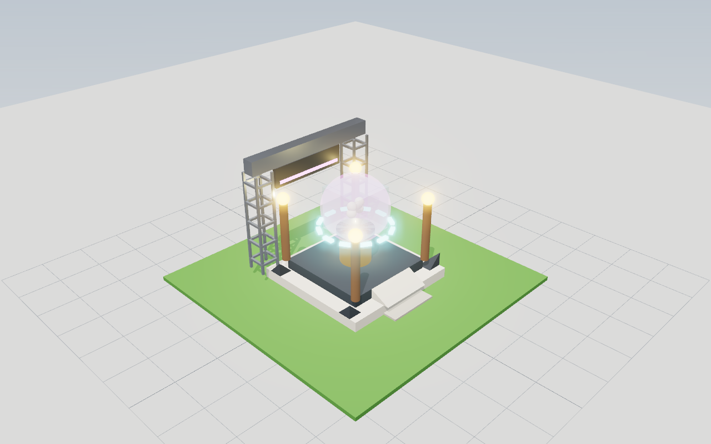

# tools/preview — see layouts without Roblox Studio

Renders `World.Spec` layouts (and regions of a `.rbxl` place) to PNG with three.js in headless
Chromium. Use it to review flasks, stands, mine levels, decor and item models.



## Setup (once)

```sh
cd tools/preview && npm install   # three + playwright-core into tools/preview/node_modules (git-ignored)
```

Chromium comes from `PLAYWRIGHT_BROWSERS_PATH` (preinstalled at `/opt/pw-browsers`); playwright-core
does not download browsers. Rendering uses SwiftShader (no GPU needed).

## Use (from the repository root)

```sh
# 1. Export a scene JSON (Lune). Sources can be combined and repeated.
lune run tools/preview/export.luau tools/preview/out/stand.json --file tools/preview/samples/stand.luau
lune run tools/preview/export.luau out.json --module ReplicatedStorage.Lab.FlaskLayout --call Build --args '[2]'
lune run tools/preview/export.luau out.json --specs my_specs.json --anchor 0,0,0,45
lune run tools/preview/export.luau out.json --place build/DOGROTS_MINING.rbxl \
    --path "Workspace/DOGROTS_District/05_MutationLab" --max 20000

# 2. Render PNGs: <prefix>_<angle>.png
node tools/preview/render.mjs tools/preview/out/stand.json tools/preview/out/stand
node tools/preview/render.mjs out.json out/lab --angles iso,front,top,close --size 1280x800 --zoom 1.5 --focus 0,10,0
```

* `--module` loads a ModuleScript from `src/` (dotted path) through `tests/lib/economy_env.luau`.
  `--call` names a function (arguments from the `--args` JSON array); it returns a spec list or
  `{Specs = list, Anchor = CFrame}`.
* `--file` evaluates a Luau file with `Spec`, `Vector3`, `CFrame`, `Color3`, `Enum`, `UDim2` and
  the sequence types in scope (see `samples/stand.luau`).
* `--specs` reads JSON parts: `Size [x,y,z]`, `CFrame [x,y,z]` / 12 numbers /
  `{"Position":[..],"Rotation":[deg,deg,deg]}`, `Color [r,g,b]` (0-255) or `"#RRGGBB"`, `Material`,
  `Transparency`, `Children` (`PointLight` children become lights).
* `--place` draws every visible BasePart under each `--path`. MeshParts and unions are drawn as
  their bounding box (`Approx`, slightly see-through); `--max` keeps the largest parts.
* Angles: `iso` (front-right, above), `front` (looks at the -Z face, the anchor's LookVector side),
  `back`, `side` (+X), `top` (-Z up), `close` (front-left, half distance). Cameras fit the bounds.

## What the renderer approximates

| Roblox | Preview |
|---|---|
| Block, Ball (smallest size), Cylinder (axis X), WedgePart (slope down to -Z), CornerWedgePart (peak at +X +Y -Z), TrussPart (rails + bars) | same geometry |
| Neon | emissive colour + bloom |
| Glass | transparent, glossy, clear coat |
| ForceField | additive see-through glow |
| Metal, DiamondPlate, Foil, CorrodedMetal | metallic with room reflections |
| Plastic, SmoothPlastic, Wood, Slate, Granite, Marble, Concrete, Brick, Grass, Sand, Ice, Basalt, CrackedLava, Cobblestone, ... | colour + roughness |
| Transparency / Reflectance | opacity / extra gloss |
| PointLight / SpotLight / SurfaceLight | point lights (the 8 strongest) |

Studio light, a ground grid of 4-stud cells and soft shadows are added. Textures, decals,
SurfaceGuis, particles and beams are not drawn. Lua-side cost, LOD and streaming still need a
Studio check (`docs/OVERHAUL.md`).
